# All Insurance Cross Sell

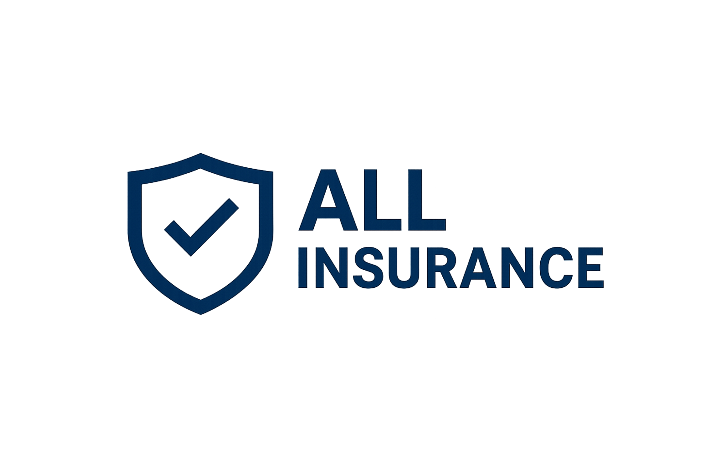

A All Insurance é uma das empresas líderes no segmento de seguros de saúde, reconhecida pela sua solidez no mercado e pelo compromisso em oferecer soluções acessíveis e confiáveis aos seus clientes. Com uma ampla base de benefícios e forte presença no setor, a empresa conquistou destaque ao combinar atendimento de qualidade e produtos personalizados que atendem diferentes perfis de consumidores.

Visando ampliar sua atuação e explorar novas oportunidades de crescimento, a All Insurance definiu como estratégia expandir sua presença para o ramo de seguros automotivos. Essa iniciativa busca não apenas diversificar o portfólio da empresa, mas também aproveitar sua relação de confiança já estabelecida com os clientes para oferecer soluções complementares de proteção.

## Problema de Negócio

O departamento de marketing da All Insurance enfrenta o desafio de identificar, dentro da sua ampla base de clientes de seguros de saúde, aqueles que possuem maior probabilidade de contratar também um seguro automotivo. Essa iniciativa é estratégica, pois a empresa, já consolidada como uma das líderes no segmento de saúde, busca expandir sua atuação para o ramo de seguros de automóveis, aproveitando a confiança e o relacionamento já estabelecido com seus clientes.

Para viabilizar esse objetivo, é necessário desenvolver um modelo de machine learning capaz de prever a propensão de cada cliente em adquirir um seguro automotivo, a partir de informações demográficas e do histórico de apólices. Dessa forma, a All Insurance poderá direcionar campanhas de marketing de forma mais assertiva, reduzir custos com clientes de baixa propensão, aumentar a taxa de conversão em ofertas de cross-sell e, consequentemente, maximizar a receita e o valor de longo prazo de sua base de clientes.

Essa abordagem permitirá à empresa não apenas diversificar seu portfólio, mas também consolidar-se como referência em soluções de proteção completas, unindo saúde e automóvel em uma única experiência de confiança e segurança.

## Planejamento da Solução

A estratégia de solução adotada neste projeto se baseia no método CRISP-DM (Cross Industry Standard Process for Data Mining), uma metodologia amplamente reconhecida e utilizada na ciência de dados. O CRISP-DM é um modelo cíclico e flexível, que permite uma abordagem estruturada e iterativa: a cada ciclo, o projeto entrega valor para o time de negócio e gera aprendizados que podem ser incorporados no ciclo seguinte. A imagem abaixo ilustra uma adaptação do CRISP-DM, destacando suas fases principais e como elas se inter-relacionam.

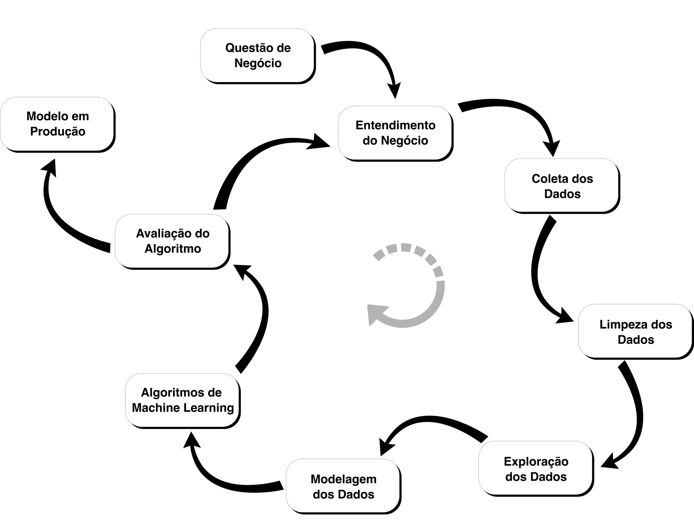

A seguir descrevo cada etapa explicando as premissas adotadas e as decisões tomadas com o objetivo de obter o melhor resultado para o problema apresentado.

### Questão de Negócio

No ano passado, a All Insurance realizou uma pesquisa com cerca de 380 mil clientes do seguro saúde sobre o interesse em aderir a um novo produto de seguro automotivo. Agora, a empresa vai lançar o produto e o time de vendas vai oferecê-lo a **127 mil novos clientes**, que não participaram da pesquisa.

O problema é que o time de vendas tem capacidade para realizar apenas **20.000 ligações** durante a campanha. Ligando para os clientes sem nenhum critério, a maior parte das ligações será feita para clientes sem interesse no produto. O objetivo deste projeto é ordenar a base de novos clientes pela propensão de compra, para que as ligações sejam feitas primeiro para os clientes com mais chance de contratar o seguro, e responder às seguintes perguntas:

1. Quais são os principais insights sobre os atributos mais relevantes dos clientes interessados em adquirir um seguro automotivo?
2. Qual a porcentagem de clientes interessados que o time de vendas consegue contatar fazendo 20.000 ligações?
3. E se a capacidade do time de vendas aumentar para 40.000 ligações, qual a porcentagem de clientes interessados contatados?
4. Quantas ligações o time de vendas precisa fazer para contatar 80% dos clientes interessados?

#### Entregas:
- **Análise Exploratória de Dados:** Geração de insights sobre o perfil dos clientes interessados no seguro automotivo.
- **Modelo de Machine Learning:** Modelo que calcula a propensão de compra de cada cliente e ordena a base para o time de vendas.
- **API:** Endpoint publicado na nuvem que recebe os dados dos clientes e devolve o score de propensão de compra.
- **Google Sheets:** Planilha em que o time de vendas calcula o score dos clientes com um clique, sem precisar de nenhum conhecimento técnico.

### Entendimento do Negócio

Atualmente, a All Insurance não possui nenhum critério para escolher quais clientes devem receber a oferta do seguro automotivo. Sem uma priorização, a taxa de conversão das ligações tende a ser igual à taxa de interesse da base: de cada 100 clientes contatados, apenas cerca de 12 têm interesse no produto. Essa abordagem aleatória é a baseline do projeto.

Como a capacidade do time de vendas é limitada, este é um problema de **ranqueamento**: o modelo calcula a probabilidade de interesse de cada cliente e essa probabilidade é usada para ordenar a base. Mais importante do que acertar se cada cliente vai ou não comprar é garantir que os clientes interessados estejam no topo da lista.

#### Coleta de Dados

Este projeto é fictício e os dados utilizados foram extraídos do dataset [Health Insurance Cross Sell Prediction](https://www.kaggle.com/datasets/anmolkumar/health-insurance-cross-sell-prediction), disponível no Kaggle. Para simular um cenário real, os dados foram armazenados em um banco de dados PostgreSQL, distribuídos em três tabelas relacionadas pela chave `id_cliente`. A coleta é feita diretamente no banco, com a query abaixo:

```sql
SELECT c.id_cliente, c.gender, c.age, c.region_code, c.driving_license,
       a.id_apolice, a.previously_insured, a.annual_premium, a.policy_sales_channel, a.vintage, a.response,
       v.id_veiculo, v.vehicle_age, v.vehicle_damage
FROM clientes c
INNER JOIN apolices a ON a.id_cliente = c.id_cliente
INNER JOIN veiculos v ON v.id_cliente = c.id_cliente
ORDER BY c.id_cliente
```

As credenciais de acesso ao banco ficam no arquivo `.env`, que não é versionado. Para executar o notebook, crie esse arquivo na raiz do projeto com as variáveis `DB_HOST`, `DB_PORT`, `DB_NAME`, `DB_SCHEMA`, `DB_USER` e `DB_PASSWORD`.

#### Dicionário de Dados

##### Tabelas
- **`clientes`**: Dados demográficos dos clientes.
- **`apolices`**: Dados da apólice do seguro saúde e a resposta da pesquisa de interesse no seguro automotivo.
- **`veiculos`**: Dados do veículo de cada cliente.

##### Campos de Dados
| Campo                          | Descrição                                                                                          |
|--------------------------------|----------------------------------------------------------------------------------------------------|
| **`id_cliente`**               | Identificador único do cliente.                                                                    |
| **`gender`**                   | Gênero do cliente: `Male` ou `Female`.                                                             |
| **`age`**                      | Idade do cliente.                                                                                  |
| **`region_code`**              | Código da região onde o cliente mora.                                                              |
| **`driving_license`**          | Indica se o cliente possui carteira de motorista: `0` = não possui, `1` = possui.                   |
| **`id_apolice`**               | Identificador único da apólice.                                                                    |
| **`previously_insured`**       | Indica se o cliente já possui seguro automotivo: `0` = não possui, `1` = possui.                    |
| **`annual_premium`**           | Valor anual pago pelo cliente no seguro saúde.                                                     |
| **`policy_sales_channel`**     | Código do canal de venda pelo qual o cliente foi captado (agentes, telefone, e-mail, presencial etc.). |
| **`vintage`**                  | Quantidade de dias desde que o cliente se associou à All Insurance.                                |
| **`response`**                 | Resposta da pesquisa: `0` = sem interesse, `1` = interessado no seguro automotivo.                  |
| **`id_veiculo`**               | Identificador único do veículo.                                                                    |
| **`vehicle_age`**              | Idade do veículo: `< 1 Year`, `1-2 Year` ou `> 2 Years`.                                           |
| **`vehicle_damage`**           | Indica se o veículo já foi danificado: `Yes` ou `No`.                                              |

### Limpeza de Dados

Com os dados carregados, a primeira tarefa feita foi separar a base em duas partes: os 381.109 clientes que responderam à pesquisa, utilizados para treinar e avaliar o modelo, e os 127.037 novos clientes, que serão ranqueados para a campanha.

- #### Valores Nulos
	- Nenhum atributo possui valores nulos. Os únicos valores ausentes estão na variável `response` e correspondem justamente aos novos clientes, que ainda não foram contatados.

- #### Tipos de Variáveis
	- `region_code` e `policy_sales_channel`: foram convertidas para o tipo inteiro (`int`), já que representam códigos e não possuem casas decimais.
	- `response`: foi convertida para o tipo inteiro (`int`) após a separação dos novos clientes.

### Feature Engineering

Pensando nas próximas etapas (EDA e Modelagem de Dados), as variáveis categóricas foram traduzidas para facilitar a leitura dos gráficos e a etapa de encoding:

- #### Variáveis Transformadas
	- `vehicle_age`: `< 1 Year`, `1-2 Year` e `> 2 Years` foram convertidas para `menos_de_1_ano`, `entre_1_e_2_anos` e `mais_de_2_anos`.
	- `vehicle_damage`: `Yes` e `No` foram convertidas para `1` e `0`.
	- `gender`: `Male` e `Female` foram convertidas para `masculino` e `feminino`.

- #### Filtragem de Variáveis
	- `id_apolice` e `id_veiculo`: foram removidas por serem chaves do banco de dados, sem nenhuma informação sobre o cliente.
	- Nenhuma linha foi removida. Mesmo os clientes sem carteira de motorista foram mantidos, já que podem contratar o seguro para um veículo utilizado por outra pessoa da família e 5% deles demonstraram interesse.

### Análise Exploratória de Dados

Após a etapa de Feature Engineering, a próxima fase deste projeto é analisar cada variável individualmente e entender sua relação com a variável alvo `response`. Para uma exploração mais estruturada do dataset, esta seção foi dividida em três categorias principais.

#### Análise Univariada

##### Variável `response`:
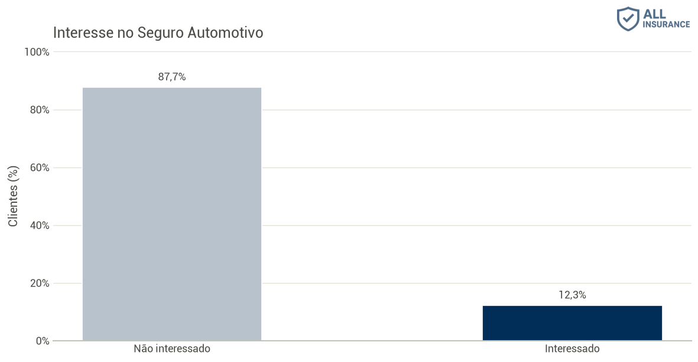

Apenas 12,3% dos clientes que responderam à pesquisa têm interesse no seguro automotivo.

**Aprendizado: Com a base desbalanceada, a acurácia não é uma boa métrica. Um modelo que classifica todos os clientes como "não interessados" acerta 87,7% das vezes e não tem nenhuma utilidade para o negócio. Por isso, o modelo foi avaliado com métricas de ranqueamento.**

##### Variáveis Numéricas:
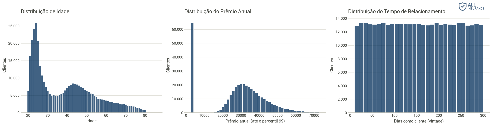

A idade dos clientes se concentra entre 20 e 30 anos, com uma segunda concentração em torno dos 45 anos. O prêmio anual possui uma cauda longa à direita e um pico no menor valor da base: **17% dos clientes pagam exatamente 2.630**, o que sugere um prêmio mínimo cobrado pela All Insurance. Já o tempo de relacionamento (`vintage`) é distribuído de forma uniforme entre 10 e 299 dias.

##### Variáveis Categóricas:
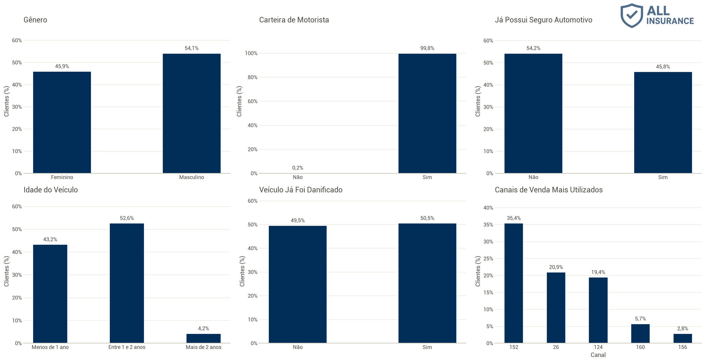

A base é equilibrada entre clientes que já tiveram ou não o veículo danificado e entre clientes que já possuem ou não um seguro automotivo. Quase todos os clientes possuem carteira de motorista (99,8%) e apenas 4,2% têm veículos com mais de 2 anos. Os três canais de venda mais utilizados concentram 76% da base.

#### Análise Bivariada

Para a Análise Bivariada, foram criadas hipóteses sobre o negócio a partir do mapa mental abaixo, com o intuito de gerar insights e entender quais atributos influenciam o interesse do cliente. Para não ser enganado pelo tamanho dos grupos, todas as hipóteses foram validadas pela **taxa de interesse** de cada grupo, e não pela quantidade de clientes interessados.

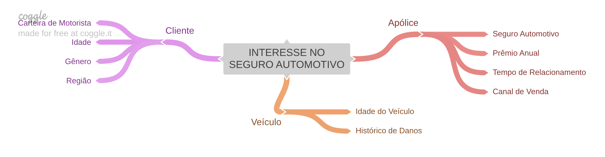

Abaixo, listo as 10 hipóteses criadas e verifico se cada uma é verdadeira ou falsa.

- ##### H1. Clientes mais velhos deveriam ter mais interesse em adquirir um seguro automotivo.
**Falsa**. O interesse não cresce continuamente com a idade: ele sobe até os 50 anos e cai a partir daí. A taxa de interesse é maior entre 31 e 50 anos (21%) e cai para 7,4% acima dos 70 anos. Os clientes de até 25 anos, que formam o maior grupo da base (30%), são os menos interessados (3,5%).

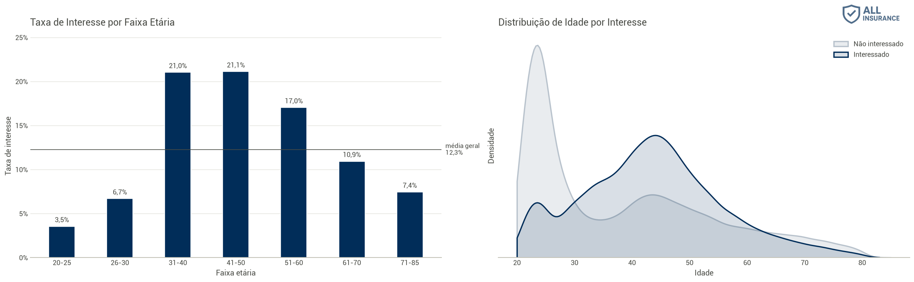

- ##### H2. Clientes do sexo masculino deveriam ter mais interesse em adquirir um seguro automotivo.
**Verdadeira**. Os clientes do sexo masculino têm uma taxa de interesse de 13,8%, contra 10,4% das clientes do sexo feminino.

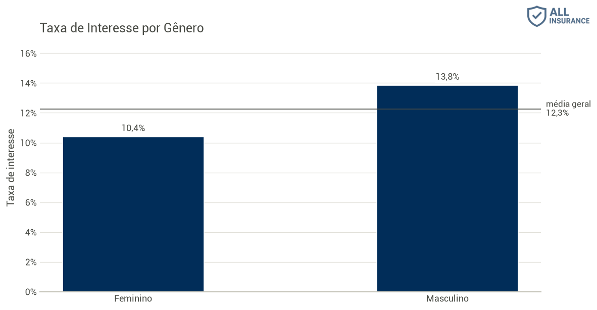

- ##### H3. Clientes com carteira de motorista deveriam ter mais interesse em adquirir um seguro automotivo.
**Verdadeira**. Os clientes com carteira de motorista têm uma taxa de interesse de 12,3%, contra 5,0% dos clientes sem carteira. No entanto, apenas 812 clientes (0,2% da base) não possuem carteira, o que torna essa variável pouco relevante.

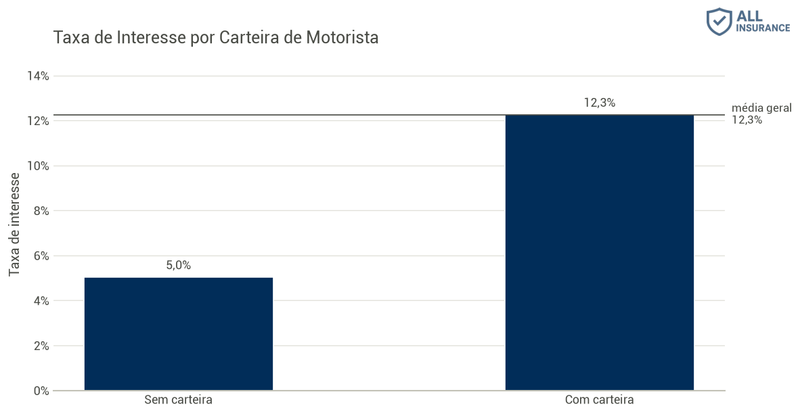

- ##### H4. Clientes de regiões com mais clientes deveriam ter mais interesse em adquirir um seguro automotivo.
**Falsa**. A região 28 concentra 28% dos clientes e tem uma das maiores taxas de interesse (18,7%). No entanto, as demais regiões grandes têm taxas abaixo da média e, sem a região 28, a correlação entre o número de clientes e a taxa de interesse das regiões é praticamente nula (-0,05).

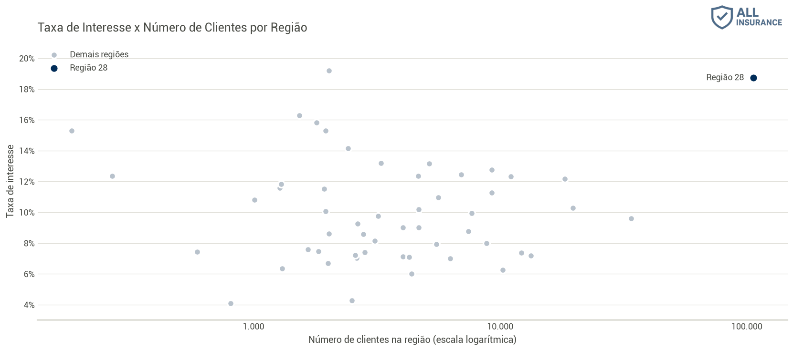

- ##### H5. Clientes com veículos mais novos deveriam ter mais interesse em adquirir um seguro automotivo.
**Falsa**. É justamente o contrário: quanto mais antigo o veículo, maior o interesse. A taxa de interesse é de 4,4% para veículos com menos de 1 ano e chega a 29,4% para veículos com mais de 2 anos.

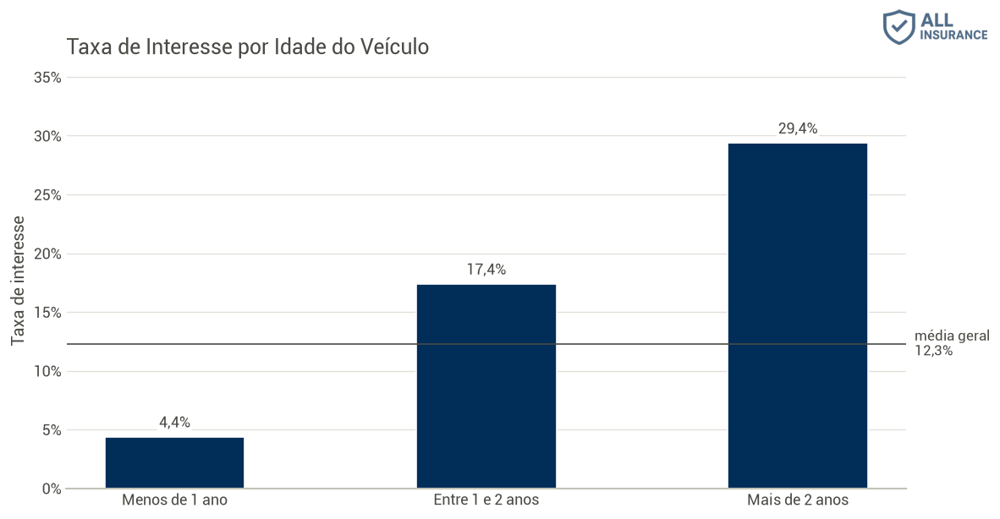

- ##### H6. Clientes que já tiveram o veículo danificado deveriam ter mais interesse em adquirir um seguro automotivo.
**Verdadeira**. Este é um dos atributos mais relevantes do projeto: 23,8% dos clientes que já tiveram o veículo danificado têm interesse no seguro, contra apenas 0,5% dos clientes sem histórico de dano.

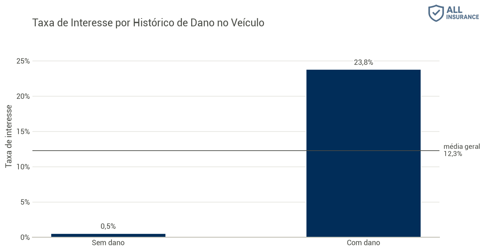

- ##### H7. Clientes que já possuem seguro automotivo deveriam ter menos interesse em adquirir um seguro automotivo.
**Verdadeira**. Os clientes que já possuem seguro automotivo praticamente não têm interesse (0,1%), enquanto 22,5% dos clientes sem seguro demonstraram interesse. Na prática, ligar para um cliente que já tem seguro é desperdiçar uma ligação.

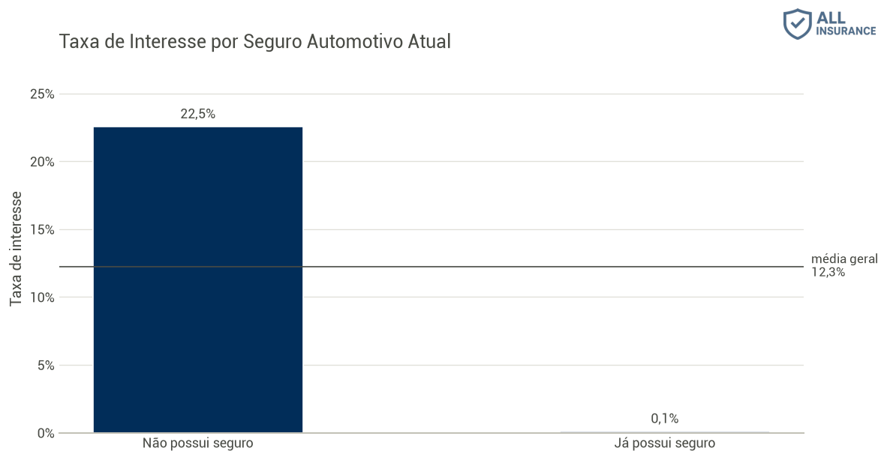

- ##### H8. Clientes que pagam um prêmio anual maior no seguro saúde deveriam ter mais interesse em adquirir um seguro automotivo.
**Verdadeira**. Desconsiderando os clientes do prêmio mínimo, a taxa de interesse sobe de forma consistente, de 9,4% na faixa de menor prêmio para 15,0% na faixa de maior prêmio. Os clientes do prêmio mínimo formam um grupo à parte, com taxa de 13,1%.

**OBS.: Por se tratar de um projeto fictício, não é possível saber por que tantos clientes pagam o prêmio mínimo. Em um projeto real, isso certamente seria explorado com o time de negócio, já que pode indicar um plano ou uma condição comercial específica.**

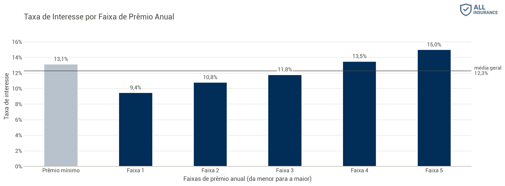

- ##### H9. Clientes com mais tempo de relacionamento com a All Insurance deveriam ter mais interesse em adquirir um seguro automotivo.
**Falsa**. O tempo de relacionamento não influencia o interesse. A distribuição de `vintage` é praticamente idêntica entre interessados e não interessados, e a taxa de interesse fica entre 12,0% e 12,5% em todas as faixas.

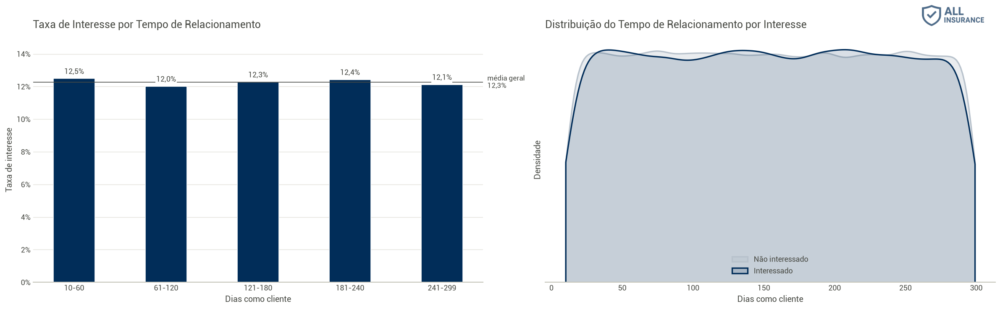

- ##### H10. Clientes captados pelos canais de venda mais utilizados deveriam ter mais interesse em adquirir um seguro automotivo.
**Falsa**. O canal mais utilizado (152), responsável por 35% dos clientes, tem uma das menores taxas de interesse (2,9%), assim como o canal 160 (2,2%). Já os canais 26 e 124, segundo e terceiro mais utilizados, têm taxas próximas de 20%.

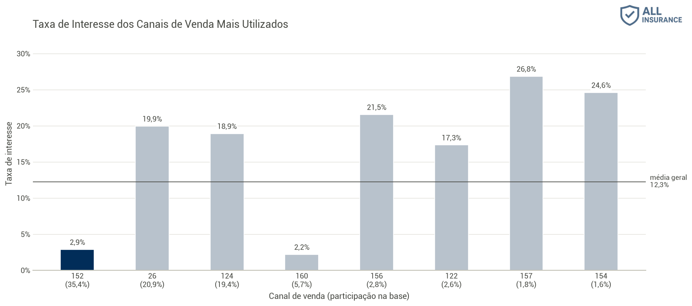

##### Resumo das Hipóteses

| Hipótese | Conclusão  | Relevância |
|----------|------------|------------|
| H1       | Falsa      | Alta       |
| H2       | Verdadeira | Média      |
| H3       | Verdadeira | Baixa      |
| H4       | Falsa      | Média      |
| H5       | Falsa      | Alta       |
| H6       | Verdadeira | Alta       |
| H7       | Verdadeira | Alta       |
| H8       | Verdadeira | Média      |
| H9       | Falsa      | Baixa      |
| H10      | Falsa      | Alta       |

#### Análise Multivariada

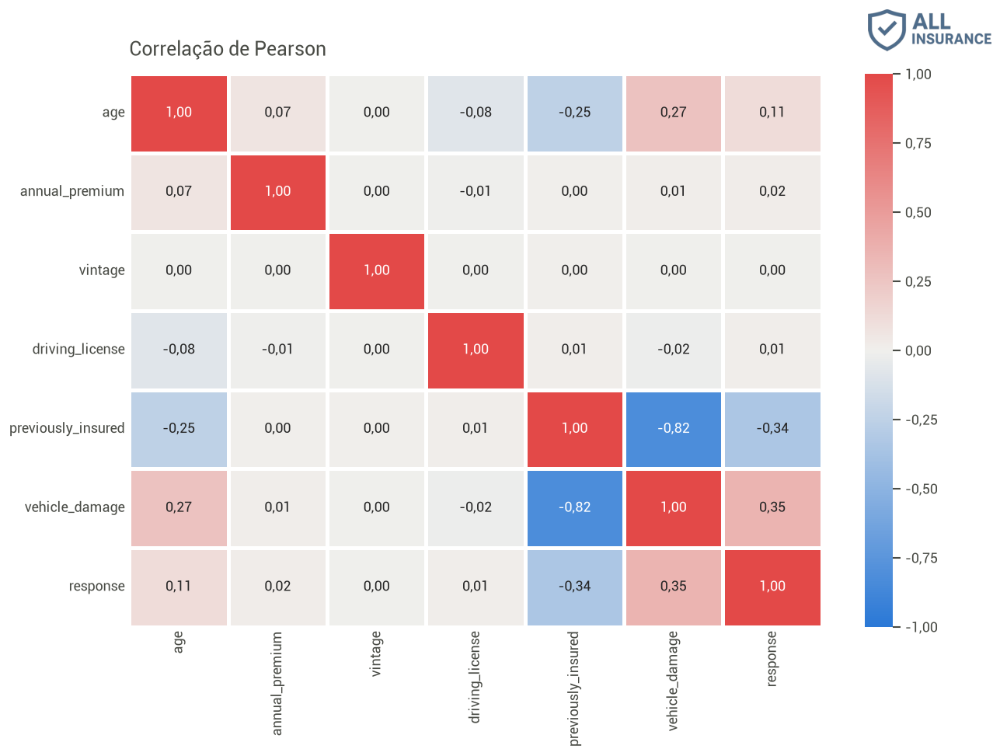

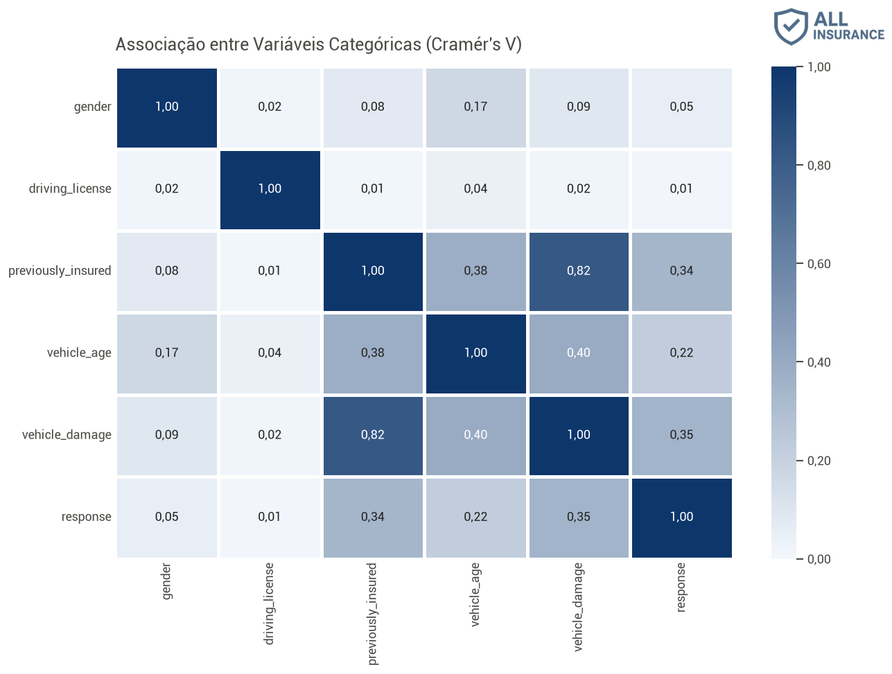

A correlação de Pearson mostra que `vehicle_damage` (0,35) e `previously_insured` (-0,34) são as variáveis mais correlacionadas com a resposta, seguidas por `age` (0,11). Já `vintage` não tem correlação com nenhuma outra variável, reforçando a conclusão da hipótese H9.

Entre as variáveis categóricas, o Cramér's V confirma que `vehicle_damage` (0,35), `previously_insured` (0,34) e `vehicle_age` (0,22) são as mais associadas à resposta. Além disso, `previously_insured` e `vehicle_damage` são fortemente associadas entre si (0,82): clientes que já possuem seguro automotivo raramente declaram dano no veículo.

### Modelagem de Dados

Antes de iniciar a etapa de teste dos algoritmos de Machine Learning, é fundamental realizar a preparação das variáveis para garantir que os algoritmos possam processá-las adequadamente. A seguir, detalho as ações realizadas.

#### Separação entre Treino e Teste
A base foi separada em treino (80%) e teste (20%) **antes** da preparação dos dados, de forma estratificada. Assim, os scalers e encoders aprendem apenas com os dados de treino e a base de teste simula clientes nunca vistos pelo modelo, evitando o vazamento de dados (*data leakage*).

#### Variáveis Numéricas
Modelos lineares e baseados em distância, como a Regressão Logística e o KNN, são sensíveis à escala das variáveis. Como nenhuma variável numérica apresenta uma distribuição normal, foi aplicado o Rescaling em vez da padronização: o `RobustScaler` em `annual_premium`, que possui muitos outliers, e o `MinMaxScaler` em `age` e `vintage`, que passam a variar entre 0 e 1.

#### Variáveis Categóricas
- `gender`: `Binary Encoding` (`feminino` = 0, `masculino` = 1).
- `vehicle_age`: `Ordinal Encoding`, respeitando a ordem natural das categorias (`menos_de_1_ano` = 0, `entre_1_e_2_anos` = 1, `mais_de_2_anos` = 2).
- `region_code` e `policy_sales_channel`: `Target Encoding` com o `TargetEncoder` do scikit-learn. Cada categoria é substituída pela taxa de interesse daquela categoria, com uma suavização para as categorias com poucos clientes. No treino, o encoder utiliza *cross fitting*: o valor de cada cliente é calculado com dados dos quais ele não faz parte, para que o encoding não carregue a resposta do próprio cliente.

#### Seleção de Features
A importância das features foi calculada de duas formas: pela redução de impureza de um modelo Extra Trees e por permutação, que mede o quanto a performance de um modelo cai quando cada feature é embaralhada.

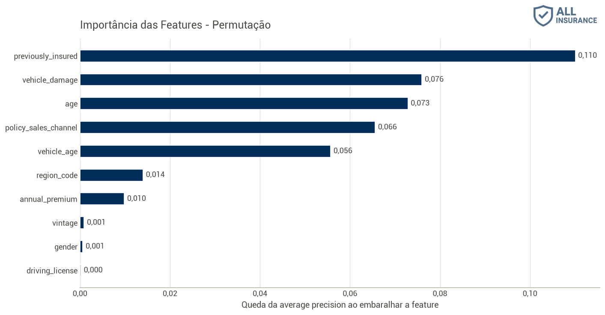

As duas abordagens apontam `previously_insured`, `vehicle_damage`, `age`, `policy_sales_channel` e `vehicle_age` como as features mais importantes. A variável `vintage` foi removida: a hipótese H9 mostrou que ela não tem relação com o interesse do cliente e sua importância por permutação é praticamente nula. `gender` e `driving_license` também têm importância baixa, mas foram mantidas por apresentarem relação com o interesse na análise exploratória. As variáveis que permaneceram no dataset foram:
```python
['age', 'gender', 'driving_license', 'region_code', 'previously_insured',
 'annual_premium', 'policy_sales_channel', 'vehicle_age', 'vehicle_damage']
```

### Algoritmos de Machine Learning

#### Métricas de Avaliação
Como o objetivo é ordenar a base para o time de vendas, os modelos foram avaliados com métricas de ranqueamento:

- **Precision@K:** dos K clientes no topo da lista, quantos têm interesse no seguro automotivo.
- **Recall@K:** do total de clientes interessados, quantos estão entre os K primeiros da lista.

Como o time de vendas consegue fazer 20.000 ligações em uma base de 127.037 novos clientes, o K corresponde a **15,74% da base avaliada**.

#### Cross Validation
Para que não ficasse muito tempo testando modelos, escolhi 1 modelo linear, 1 modelo baseado em distância e 4 modelos baseados em árvores. Todos foram avaliados com Cross Validation estratificado (5 folds) na base de treino e comparados com o Random Model, que representa a escolha aleatória dos clientes.

| Id | Model Name          | Precision@K CV  | Recall@K CV     | ROC AUC CV      |
|----|---------------------|-----------------|-----------------|-----------------|
|  1 | XGBoost             | 0.3710 ± 0.0048 | 0.4766 ± 0.0062 | 0.8567 ± 0.0023 |
|  2 | LightGBM            | 0.3710 ± 0.0052 | 0.4765 ± 0.0067 | 0.8569 ± 0.0021 |
|  3 | Extra Trees         | 0.3691 ± 0.0036 | 0.4740 ± 0.0046 | 0.8555 ± 0.0018 |
|  4 | Random Forest       | 0.3574 ± 0.0036 | 0.4591 ± 0.0047 | 0.8506 ± 0.0019 |
|  5 | KNN                 | 0.3475 ± 0.0040 | 0.4463 ± 0.0051 | 0.8445 ± 0.0016 |
|  6 | Logistic Regression | 0.3412 ± 0.0035 | 0.4383 ± 0.0045 | 0.8437 ± 0.0018 |
|  7 | Random Model        | 0.1220          | 0.1568          | 0.4990          |

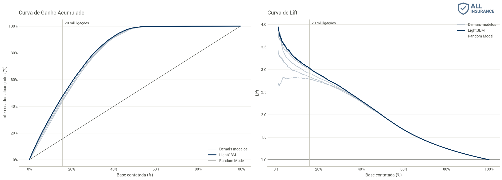

Os modelos baseados em árvores com boosting, **XGBoost** e **LightGBM**, apresentaram os melhores resultados, praticamente empatados. Ambos alcançam cerca de 3 vezes mais interessados do que o Random Model com a mesma quantidade de ligações. O **LightGBM** foi o escolhido para seguir para o Hyperparameter Fine Tuning: a performance é equivalente à do XGBoost, mas o treinamento foi mais rápido e o modelo final é um pouco menor, o que agiliza o Fine Tuning e facilita a manutenção da API em produção.

#### Hyperparameter Fine Tuning

Nesta etapa, foi realizada a otimização dos parâmetros do **LightGBM** com Random Search. Para cada conjunto de parâmetros sorteado, o modelo foi avaliado com o mesmo Cross Validation estratificado, e o melhor conjunto foi escolhido pelo maior Recall@K médio e, em caso de empate, pelo maior ROC AUC médio. O modelo final foi treinado com toda a base de treino e avaliado na base de teste, que não foi utilizada no treinamento, no Cross Validation nem no Fine Tuning:

| Model Name     | Base                      | Precision@K     | Recall@K        | ROC AUC         |
|----------------|---------------------------|-----------------|-----------------|-----------------|
| LightGBM Tuned | Cross Validation (treino) | 0.3720 ± 0.0046 | 0.4778 ± 0.0059 | 0.8576 ± 0.0020 |
| LightGBM Tuned | Teste                     | 0.3706          | 0.4760          | 0.8581          |

Os melhores parâmetros encontrados foram:
```python
{'n_estimators': 200, 'learning_rate': 0.03, 'num_leaves': 63, 'min_child_samples': 50,
 'subsample': 0.85, 'colsample_bytree': 0.8, 'reg_lambda': 0}
```

A performance na base de teste é equivalente à performance do Cross Validation, ou seja, o modelo generaliza bem para clientes que ele nunca viu e não há sinais de overfitting. Na prática, de cada 100 clientes no topo da lista, cerca de 37 têm interesse no seguro automotivo, contra 12 em uma escolha aleatória.

### Avaliação do Algoritmo

Com o modelo final definido e os resultados em mãos, é fundamental comunicar essas métricas técnicas de forma acessível ao time de negócio. Para isso, o desempenho do modelo na base de teste foi projetado para a base de 127.037 novos clientes. Como 12,3% dos clientes da pesquisa demonstraram interesse, estima-se que existam cerca de 15.570 clientes interessados entre os novos clientes.

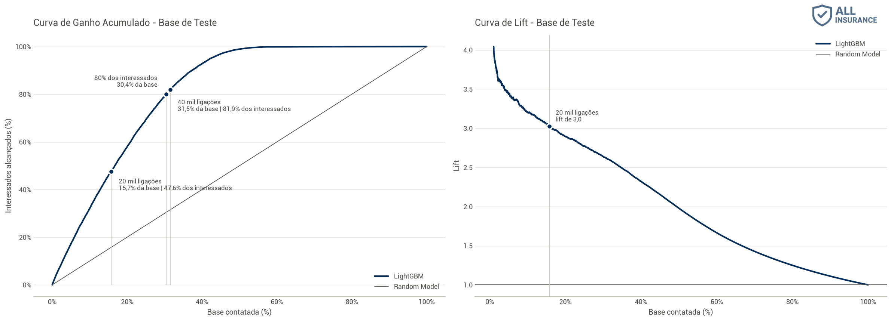

A curva de ganho acumulado mostra a porcentagem dos clientes interessados alcançados à medida que o time de vendas avança na lista. Já a curva de lift mostra quantas vezes o modelo é melhor do que a escolha aleatória.

#### 1. Quais são os principais insights sobre os atributos mais relevantes dos clientes interessados?
- Clientes que **já possuem seguro automotivo** praticamente não têm interesse (0,1%).
- Clientes que **já tiveram o veículo danificado** têm interesse cerca de 46 vezes maior do que os demais (23,8% contra 0,5%).
- O interesse **cresce com a idade do veículo**, ao contrário do que se esperava: 29,4% para veículos com mais de 2 anos.
- Os clientes **entre 31 e 50 anos** são os mais interessados (21%), enquanto os clientes de até 25 anos, maior grupo da base, são os menos interessados.
- O **canal de venda** faz muita diferença: o canal mais utilizado (152) tem taxa de interesse de apenas 2,9%.

#### 2. Qual a porcentagem de clientes interessados que o time de vendas consegue contatar fazendo 20.000 ligações?
Fazendo 20.000 ligações (15,7% da base), o time de vendas contata **47,6% dos clientes interessados**, cerca de 7.412 clientes. Ligando sem nenhum critério, seriam apenas 2.451 clientes interessados (15,7%). Ou seja, o modelo encontra **3 vezes mais interessados** com a mesma quantidade de ligações.

#### 3. E se a capacidade do time de vendas aumentar para 40.000 ligações?
Fazendo 40.000 ligações (31,5% da base), o time de vendas contata **81,9% dos clientes interessados**, cerca de 12.745 clientes, contra 4.903 em uma escolha aleatória.

#### 4. Quantas ligações o time de vendas precisa fazer para contatar 80% dos clientes interessados?
O time de vendas precisa ligar para 30,4% da base: **38.662 ligações**. Sem o modelo, seriam necessárias 101.630 ligações (80% da base).

#### Resultado para o Negócio

| Cenário              | Ligações | Interessados alcançados (modelo) | Interessados alcançados (aleatório) | Ganho |
|----------------------|----------|----------------------------------|-------------------------------------|-------|
| Capacidade atual     | 20.000   | 7.412 (47,6%)                    | 2.451 (15,7%)                       | 3,0x  |
| Capacidade dobrada   | 40.000   | 12.745 (81,9%)                   | 4.903 (31,5%)                       | 2,6x  |
| 80% dos interessados | 38.662   | 12.456 (80,0%)                   | 4.739 (30,4%)                       | 2,6x  |

Com o modelo, o time de vendas alcança 3 vezes mais clientes interessados com as mesmas 20.000 ligações. Para alcançar os mesmos 7.412 interessados sem o modelo, seriam necessárias 60.472 ligações. Ou seja, **o modelo economiza mais de 40 mil ligações (66,9% a menos)**, reduzindo o custo da campanha e aumentando a taxa de conversão das ofertas de cross-sell.

### Deploy do Modelo

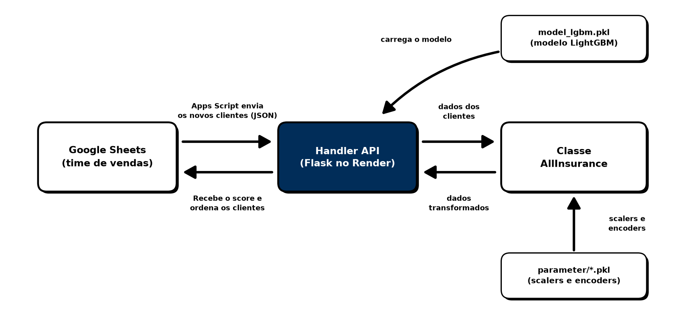

Com o modelo escolhido, treinado e com bom desempenho, o próximo passo foi colocá-lo em produção. A ideia é que o time de vendas consiga calcular a propensão de compra dos clientes diretamente em uma planilha do Google Sheets, ferramenta que ele já utiliza no dia a dia, sem precisar de nenhum conhecimento técnico.

Para viabilizar essa funcionalidade, desenvolvemos duas peças: a API, que calcula o score de propensão de compra, e um script do Google Apps Script, que conecta a planilha à API.

#### API de Previsão
Essa API é responsável por calcular o score de propensão de compra de cada cliente. Ela foi desenvolvida com Flask, empacotada em um container Docker e publicada no [Heroku](https://www.heroku.com), com o build da imagem descrito no arquivo [`heroku.yml`](heroku.yml).

O processo funciona da seguinte forma: a API recebe os dados dos clientes em formato JSON, no mesmo formato das tabelas do banco de dados. A classe `AllInsurance` carrega os scalers e encoders salvos durante o treinamento, aplica as mesmas transformações do notebook e seleciona as features na mesma ordem utilizada no treinamento. Em seguida, o modelo calcula a probabilidade de cada cliente ter interesse no seguro automotivo.

A resposta da API inclui os dados originais dos clientes, acrescidos da coluna `score`. Para garantir que a API reproduz exatamente o modelo do notebook, os scores devolvidos pela API foram comparados com os scores calculados no notebook para uma amostra de novos clientes.

Como os dados podem ser digitados na planilha, a API também valida a entrada: espaços extras e diferenças entre maiúsculas e minúsculas são ignorados, enquanto colunas ausentes, categorias desconhecidas ou valores numéricos inválidos retornam um erro `400` com a descrição do problema, em vez de um score incorreto. Esses comportamentos são verificados pelos testes automatizados em [`tests/test_api.py`](tests/test_api.py).

```bash
curl -X POST https://all-insurance-api.onrender.com/allinsurance/predict \
     -H "Content-Type: application/json" \
     -d '[{"id_cliente": 381110, "gender": "Male", "age": 25, "region_code": 11, "driving_license": 1,
           "previously_insured": 1, "annual_premium": 35786.0, "policy_sales_channel": 152,
           "vintage": 53, "vehicle_age": "< 1 Year", "vehicle_damage": "No"}]'
```

#### Planilha no Google Sheets
A planilha recebe a lista de novos clientes exportada do banco de dados. Pelo menu **All Insurance**, o time de vendas tem duas opções:

- **Calcular propensão de compra:** envia para a API apenas as colunas que o modelo utiliza, escreve o score de cada cliente e ordena a lista do maior para o menor score.
- **Destacar clientes para ligação:** pergunta quantas ligações o time consegue fazer e destaca os clientes do topo do ranking.

Para montar a planilha:
1. Importe o arquivo [`google-sheets/novos_clientes_amostra.csv`](google-sheets/novos_clientes_amostra.csv) em uma planilha nova do Google Sheets.
2. Acesse **Extensões > Apps Script**, cole o conteúdo de [`google-sheets/all_insurance.gs`](google-sheets/all_insurance.gs) e substitua a constante `API_URL` pela URL da API publicada.
3. Salve o script e recarregue a planilha. O menu **All Insurance** aparecerá ao lado do menu **Ajuda**. Na primeira execução, o Google pede autorização para o script acessar a planilha e se conectar a um serviço externo (a API).

**OBS.: No plano Eco do Heroku, a API "dorme" após 30 minutos sem uso e leva alguns segundos para responder à primeira requisição. O script já trata esse comportamento, tentando novamente até a API ficar disponível.**

## Próximos Passos

Como o CRISP-DM é um processo cíclico, alguns pontos podem ser explorados no próximo ciclo do projeto:

- Entender com o time de negócio o significado dos clientes que pagam o prêmio mínimo e dos canais de venda com taxas de interesse muito baixas.
- Incorporar o custo de cada ligação e a receita de cada venda para definir a quantidade de ligações que maximiza o lucro da campanha.
- Retreinar o modelo com toda a base de clientes que responderam à pesquisa (treino + teste), reajustando os scalers e encoders, e atualizar a API.
- Monitorar a taxa de conversão real da campanha para acompanhar a performance do modelo ao longo do tempo.

## Estrutura do Projeto

```
all-insurance/
├── api/
│   ├── allinsurance/AllInsurance.py   # classe com as transformações dos dados
│   ├── handler.py                     # API em Flask
│   ├── model/model_lgbm.pkl           # modelo final
│   ├── parameter/                     # scalers e encoders
│   ├── Dockerfile                     # imagem da API para o deploy
│   └── requirements.txt
├── google-sheets/
│   ├── all_insurance.gs               # Apps Script da planilha
│   └── novos_clientes_amostra.csv     # amostra de novos clientes
├── fonts/                             # fonte Roboto, utilizada nos gráficos
├── images/
├── notebooks/all_insurance.ipynb      # ciclo completo do projeto
├── tests/
│   ├── test_api.py                    # testes automatizados da API (pytest)
│   └── requisicao_api.py              # requisição de exemplo para a API local ou publicada
├── heroku.yml                         # build da API no Heroku
└── requirements.txt
```
